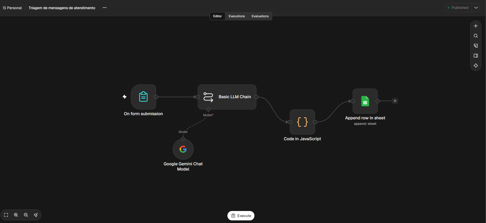
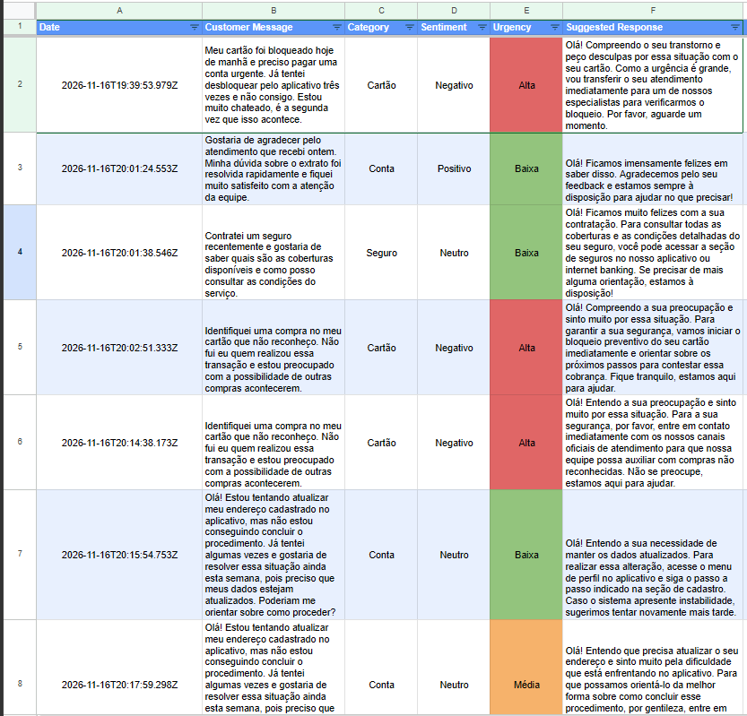

# AI Workflow Automation

AI-powered customer service triage automation using n8n, Google Gemini and Google Sheets.

## Overview

This project is an AI-powered workflow designed to automate the initial triage of customer service messages.

Using Google Gemini, the workflow analyzes customer messages, identifies their category, detects sentiment, classifies urgency, and generates empathetic response suggestions in Portuguese.

The results are automatically processed using JavaScript and stored in Google Sheets.

## Objectives

- Automate the initial classification of customer service messages.
- Identify customer sentiment and urgency levels.
- Generate professional and empathetic response suggestions.
- Organize analyzed information in a structured spreadsheet.
- Demonstrate the practical application of Generative AI in workflow automation.

## Workflow Architecture

The automation follows four main steps:

1. **Form Submission:** Receives customer messages through an n8n form.
2. **AI Analysis:** Google Gemini analyzes the message and identifies its category, sentiment and urgency.
3. **Data Processing:** JavaScript extracts and organizes the information returned by the AI.
4. **Data Storage:** Google Sheets automatically stores the results.

### Workflow

```text
Customer Message
       |
       v
   n8n Form
       |
       v
 Google Gemini
   AI Analysis
       |
       v
 JavaScript Code
 Data Processing
       |
       v
  Google Sheets
 Data Storage
```

## Main Features

- Customer message classification.
- Sentiment analysis.
- Urgency detection.
- AI-generated response suggestions.
- Automated data processing.
- Automatic spreadsheet updates.
- Prompt engineering with additional safety instructions.

## Classification Criteria

### Categories

- Card
- Account
- Insurance
- Others

### Sentiment

- Positive
- Neutral
- Negative

### Urgency

- **High:** Suspected fraud, unrecognized transactions, immediate financial risks or critical access issues.
- **Medium:** Recurring difficulties, service limitations or requests with a defined deadline.
- **Low:** General questions, informational requests and situations without significant impact.

## Technologies Used

| Technology | Purpose |
|---|---|
| n8n | Workflow automation |
| Google Gemini | Generative AI and message analysis |
| JavaScript | Data extraction and processing |
| Google Sheets | Data storage and organization |

## Project Documentation

- [System Architecture](docs/architecture.md)
- [Workflow Documentation](workflow/README.md)
- [n8n Workflow Export](workflow/workflow.example.json)

## Screenshots

### n8n Workflow Overview

Visual representation of the automated workflow and its connected nodes.



### Google Sheets Results

Example of AI-generated customer service triage results stored in Google Sheets.



## Testing

The workflow was tested with different simulated customer scenarios, including:

- Blocked credit cards.
- Positive customer feedback.
- Insurance coverage questions.
- Unrecognized card transactions.
- Difficulties updating account information.

The tests were used to evaluate classification accuracy, urgency detection and response safety.

## Safety Considerations

The workflow includes additional prompt instructions to improve the reliability and safety of generated responses.

The AI is instructed to:

- Never claim to have performed banking operations.
- Never promise transactions, cancellations or account changes.
- Never claim to have blocked or unlocked a card.
- Never promise results or resolution times.
- Direct customers reporting suspected fraud to official bank channels.
- Never request confidential information such as passwords or CVV codes.

This project is a prototype for educational and portfolio purposes. It does not connect to banking systems or perform real financial operations.

## Setup and Configuration

To reproduce this workflow, you will need:

1. An n8n account.
2. A Google Gemini API credential.
3. A Google Sheets account and spreadsheet.
4. An n8n form configured to receive customer messages.

Configure the following integrations in n8n:

- Google Gemini Chat Model.
- Google Sheets.

Make sure to configure your credentials securely within n8n.

**Important:** Never commit API keys, passwords, private credentials or confidential customer information to this repository.

## Future Improvements

- Support for additional message categories.
- More advanced sentiment analysis.
- Improved classification using structured AI output.
- Integration with other customer service platforms.
- Performance evaluation using a larger test dataset.

## Author

Developed as a portfolio project to demonstrate practical applications of Generative AI, prompt engineering and workflow automation.
